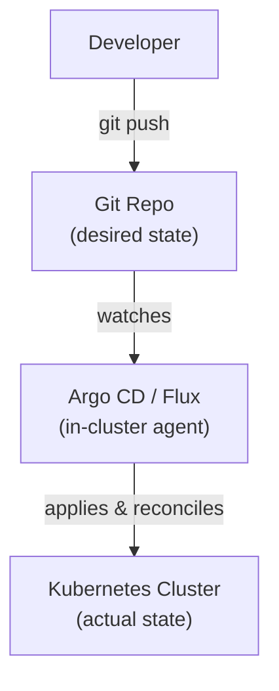
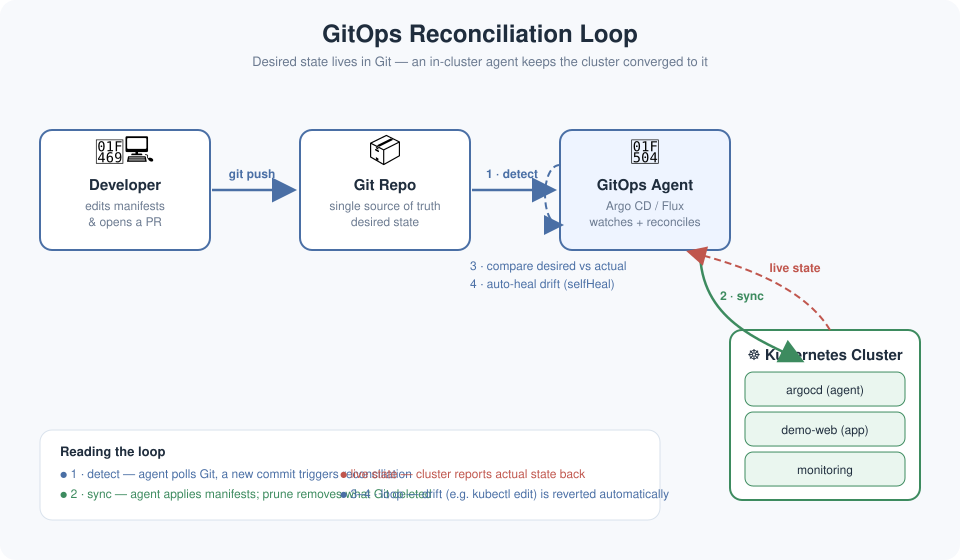

# Kubernetes GitOps Guide


> Stop pushing to production. Start merging to production.

## TL;DR

GitOps flips the deployment model: instead of your CI pipeline **pushing** changes into the cluster (`kubectl apply` from Jenkins), an in-cluster agent **pulls** the desired state from Git and reconciles it continuously. Git becomes the single source of truth — every change is a commit: reviewable, auditable, and instantly roll-back-able.



## 🌍 In plain words — what is this, really?

Imagine a restaurant kitchen. In the old way of working (**push-based**), every time the menu changes, the head chef runs into the kitchen, shouts new instructions, and hopes every cook heard correctly. If someone mishears, or a cook quietly changes a recipe at 2 AM, nobody finds out until a customer complains.

**GitOps** works like a recipe book pinned to the kitchen wall instead. The recipe book is Git: one shared book that says exactly how every dish should be made. Nobody shouts instructions into the kitchen anymore — instead, a **sous-chef** (the GitOps agent, Argo CD or Flux) stands in the kitchen all day, recipe book in hand, constantly checking: *does what's on the plates match what's in the book?* If a cook changed something by hand, the sous-chef puts it back to match the book. If the head chef wants a change, they don't run into the kitchen — they edit the recipe book, and the sous-chef picks it up within seconds.

Three ideas from that picture carry the whole guide:

- **Git is the recipe book (single source of truth).** If a change isn't written in Git, it doesn't officially exist — just like a dish that isn't in the recipe book isn't on the menu.
- **The agent is the sous-chef (reconciliation loop).** It doesn't wait to be told; it watches Git and the cluster non-stop and closes any gap between them.
- **A change is a commit (reviewable, reversible).** Want to roll back? You don't re-run a pipeline and pray — you revert one commit, exactly like crossing out a recipe edit.

If you only remember one sentence: **GitOps means the cluster copies Git, not the other way around.**

## The Problem With Push-Based Deployments

Traditional CI/CD: your pipeline gets cluster credentials, runs `kubectl apply`, and hopes for the best. The problems:

- **Credential sprawl** — every pipeline needs cluster admin access.
- **Drift** — someone runs `kubectl edit` at 2 AM; nobody knows the cluster no longer matches the manifests.
- **No audit trail** — "who changed the replica count?" → shrug.
- **Rollbacks are scary** — re-running an old pipeline is not the same as the old state.

GitOps solves all four by making the cluster converge to Git, not to whatever the last pipeline did.

## Architecture



The reconciliation loop, in four steps:

1. **Declare** — you commit Kubernetes manifests (or Helm/Kustomize) to a Git repo.
2. **Detect** — Argo CD / Flux watches the repo and notices the commit within seconds.
3. **Sync** — the agent applies the desired state to the cluster.
4. **Heal** — a background loop continuously compares *desired* (Git) vs *actual* (cluster) and auto-corrects drift.

## Argo CD vs Flux vs kubectl-push

| | Traditional push (`kubectl apply` in CI) | Argo CD | Flux |
|---|---|---|---|
| Deployment direction | Push from CI | Pull by in-cluster agent | Pull by in-cluster agent |
| Cluster credentials in CI | Required (broad) | Not needed | Not needed |
| Drift detection | None | Continuous, with auto-heal | Continuous, with auto-heal |
| Rollback | Re-run old pipeline | `git revert` | `git revert` |
| UI / visibility | Logs only | Rich web UI, diff view | CLI + web UI (Weave GitOps) |
| Multi-cluster | Pipeline matrix | Native (one control plane, many targets) | Native (per-cluster agents) |
| Learning curve | Low | Medium | Medium |

## Quick Start: Your First Argo CD Application

Install Argo CD, then declare an app the GitOps way — with a single manifest:

```yaml
apiVersion: argoproj.io/v1alpha1
kind: Application
metadata:
  name: demo-web
  namespace: argocd
spec:
  project: default
  source:
    repoURL: https://github.com/sepkascurty-cpu/kubernetes-gitops-guide
    targetRevision: HEAD
    path: apps/demo-web
  destination:
    server: https://kubernetes.default.svc
    namespace: demo-web
  syncPolicy:
    automated:
      prune: true      # delete resources removed from Git
      selfHeal: true    # revert manual kubectl edits
```

Apply it once — after that, you never touch the cluster directly again:

```bash
kubectl apply -f application.yaml
argocd app get demo-web        # watch it sync
argocd app diff demo-web       # see desired vs actual
```

The full working example lives in [`application.yaml`](application.yaml) — it includes the `Application` manifest plus the sample app (Deployment + Service) it manages.

## Repository Layout

```
.
├── README.md            # this guide
├── architecture.svg     # GitOps reconciliation-loop diagram
└── application.yaml     # Argo CD Application + sample app manifests
```

## Golden Rules of GitOps

1. **Git is the source of truth.** If it's not in Git, it doesn't exist.
2. **Separate config from code.** App repo holds the Dockerfile; env repo holds the manifests (per environment).
3. **Never `kubectl edit` in production.** Change Git, let the agent sync.
4. **Use `prune` + `selfHeal` carefully.** Powerful against drift; dangerous with a bad commit — which is why every change goes through PR review.
5. **Secrets don't belong in Git.** Use sealed-secrets, external-secrets, or SOPS.

## Best Practices

These are the habits that separate a GitOps setup that *works* from one that survives real incidents:

- **One repo per environment, or one repo with one folder per environment.** Mixing `dev`, `staging`, and `prod` manifests in a single folder is how a test change accidentally reaches production. A common layout is `apps/<app>/<env>/` — the same app, three folders, three review scopes.
- **Review every change as a pull request — no direct pushes to the GitOps branch.** The PR *is* your deployment approval. Argo CD can even show you the exact diff before it syncs, so the reviewer sees precisely what the cluster will become.
- **Pin versions, never use `latest` or floating tags.** `image: myapp:latest` means Git says one thing while the cluster quietly runs whatever `latest` happened to be that day — the reconciliation loop can't detect a change it can't see. Pin an immutable tag or image digest (`myapp:1.4.2` or `myapp@sha256:…`).
- **Let CI update image tags, let GitOps deploy them.** A good split of duties: the CI pipeline builds the image and opens a PR that bumps the tag in Git; the GitOps agent does the actual deployment. CI never touches the cluster, and every deploy still has a commit behind it.
- **Start with manual sync, turn on auto-sync later.** When you're learning, sync by clicking the button in the Argo CD UI and watch what happens. Enable `automated` sync only once you trust the pipeline — and always pair it with PR review.
- **Use ApplicationSets (Argo CD) or Kustomize overlays for multi-cluster.** Copy-pasting one `Application` per cluster doesn't scale. Generate them from a template so adding a cluster is one line in Git, not a new YAML file.
- **Monitor the agent itself.** If Argo CD or Flux goes down, deployments silently stop. Alert on sync failures and on `OutOfSync` status lasting more than a few minutes — the agent is now part of your critical path.
- **Keep secrets out of Git — always.** The manifests in Git are readable by everyone with repo access. Encrypt secrets with Sealed Secrets or SOPS, or pull them at runtime with External Secrets Operator; never commit a raw password, token, or kubeconfig.

## Troubleshooting

| Symptom | Likely cause | What to check / fix |
|---|---|---|
| App stuck in `OutOfSync`, never syncs | Auto-sync is off, or sync is blocked by a failed hook | `argocd app get <app>` — check `Sync Policy`. If `Automated` is missing, sync manually once or add `syncPolicy.automated` to the Application. Check `argocd app history` for a failed sync attempt. |
| App shows `OutOfSync` right after a manual `kubectl` change | That's self-heal working as designed (or not enabled) | If `selfHeal: true`, wait ~3 minutes — the agent reverts the edit. If the change keeps coming back and you *wanted* it, commit the change to Git instead of editing the cluster. |
| `Unknown` / `Progressing` forever after deploy | A Deployment can't become ready (bad image, CrashLoopBackOff, missing resource) | `kubectl get pods -n <namespace>` and `kubectl describe pod <pod>` — fix the workload, not the GitOps agent. The agent only applies what Git says. |
| Sync fails with `permission denied` / RBAC errors | The agent's ServiceAccount lacks rights on the target namespace | Check the Argo CD `argocd-application-controller` ClusterRole bindings, and the `project` roles in `argocd-cm`. Give the agent the least privilege it needs — usually `admin` on the app namespaces, nothing cluster-wide unless required. |
| `repository not accessible` in Argo CD UI | Wrong repo URL, missing credentials, or private repo without a deploy key | In Argo CD → Settings → Repositories, test the connection. For private repos add an SSH deploy key or HTTPS credentials with read-only scope. |
| Flux `Kustomization` stuck at `Reconciliation failed` | Bad YAML, missing Kustomize base, or a dependency that never became ready | `flux get kustomizations -A` then `flux logs --kind=Kustomization --name=<name>`. Fix the manifest in Git — Flux re-reconciles automatically. |
| Rollback didn't restore the old state | The revert commit changed Git, but the app still points at a newer revision | Confirm the Application's `targetRevision` (HEAD follows the branch tip; a pinned SHA doesn't). After `git revert`, check `argocd app history` — the sync should follow within a minute. |
| Two apps fight over the same resource | Overlapping manifests in two GitOps apps | Each resource should be owned by exactly one Application. Use `argocd app resources` to find the overlap and remove the duplicate manifest from one repo path. |

---

Built as a daily cloud-engineering write-up. PRs welcome — that's the GitOps way. 🤝
