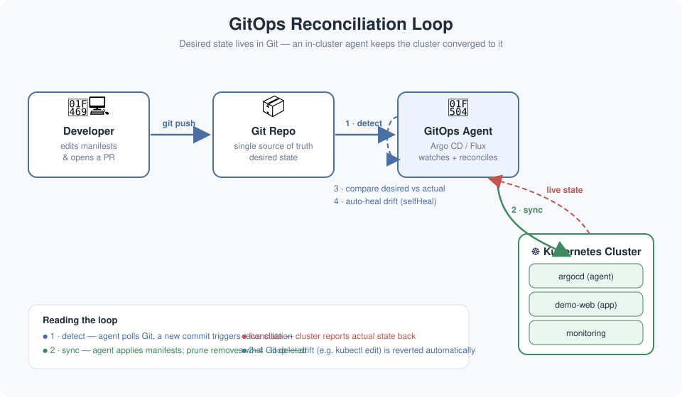

# Kubernetes GitOps Guide


> Stop pushing to production. Start merging to production.

## TL;DR

GitOps flips the deployment model: instead of your CI pipeline **pushing** changes into the cluster (`kubectl apply` from Jenkins), an in-cluster agent **pulls** the desired state from Git and reconciles it continuously. Git becomes the single source of truth — every change is a commit: reviewable, auditable, and instantly roll-back-able.

```mermaid
Developer → git push → Git Repo (desired state)
                            ↓  watches
                       Argo CD / Flux (in-cluster agent)
                            ↓  applies & reconciles
                       Kubernetes Cluster (actual state)
```

## The Problem With Push-Based Deployments

Traditional CI/CD: your pipeline gets cluster credentials, runs `kubectl apply`, and hopes for the best. The problems:

- **Credential sprawl** — every pipeline needs cluster admin access.
- **Drift** — someone runs `kubectl edit` at 2 AM; nobody knows the cluster no longer matches the manifests.
- **No audit trail** — "who changed the replica count?" → shrug.
- **Rollbacks are scary** — re-running an old pipeline is not the same as the old state.

GitOps solves all four by making the cluster converge to Git, not to whatever the last pipeline did.

## Architecture



The reconciliation loop, in four steps:

1. **Declare** — you commit Kubernetes manifests (or Helm/Kustomize) to a Git repo.
2. **Detect** — Argo CD / Flux watches the repo and notices the commit within seconds.
3. **Sync** — the agent applies the desired state to the cluster.
4. **Heal** — a background loop continuously compares *desired* (Git) vs *actual* (cluster) and auto-corrects drift.

## Argo CD vs Flux vs kubectl-push

| | Traditional push (`kubectl apply` in CI) | Argo CD | Flux |
|---|---|---|---|
| Deployment direction | Push from CI | Pull by in-cluster agent | Pull by in-cluster agent |
| Cluster credentials in CI | Required (broad) | Not needed | Not needed |
| Drift detection | None | Continuous, with auto-heal | Continuous, with auto-heal |
| Rollback | Re-run old pipeline | `git revert` | `git revert` |
| UI / visibility | Logs only | Rich web UI, diff view | CLI + web UI (Weave GitOps) |
| Multi-cluster | Pipeline matrix | Native (one control plane, many targets) | Native (per-cluster agents) |
| Learning curve | Low | Medium | Medium |

## Quick Start: Your First Argo CD Application

Install Argo CD, then declare an app the GitOps way — with a single manifest:

```yaml
apiVersion: argoproj.io/v1alpha1
kind: Application
metadata:
  name: demo-web
  namespace: argocd
spec:
  project: default
  source:
    repoURL: https://github.com/sepkascurty-cpu/kubernetes-gitops-guide
    targetRevision: HEAD
    path: apps/demo-web
  destination:
    server: https://kubernetes.default.svc
    namespace: demo-web
  syncPolicy:
    automated:
      prune: true      # delete resources removed from Git
      selfHeal: true    # revert manual kubectl edits
```

Apply it once — after that, you never touch the cluster directly again:

```bash
kubectl apply -f application.yaml
argocd app get demo-web        # watch it sync
argocd app diff demo-web       # see desired vs actual
```

The full working example lives in [`application.yaml`](application.yaml) — it includes the `Application` manifest plus the sample app (Deployment + Service) it manages.

## Repository Layout

```
.
├── README.md            # this guide
├── architecture.svg     # GitOps reconciliation-loop diagram
├── application.yaml     # Argo CD Application + sample app manifests
└── quiz.md              # test yourself: 5 questions
```

## Golden Rules of GitOps

1. **Git is the source of truth.** If it's not in Git, it doesn't exist.
2. **Separate config from code.** App repo holds the Dockerfile; env repo holds the manifests (per environment).
3. **Never `kubectl edit` in production.** Change Git, let the agent sync.
4. **Use `prune` + `selfHeal` carefully.** Powerful against drift; dangerous with a bad commit — which is why every change goes through PR review.
5. **Secrets don't belong in Git.** Use sealed-secrets, external-secrets, or SOPS.

## 🧠 Quiz

Think you've got it? Head to [`quiz.md`](quiz.md) for 5 questions — from "push vs pull" to a real drift scenario.

---

Built as a daily cloud-engineering write-up. PRs welcome — that's the GitOps way. 🤝
